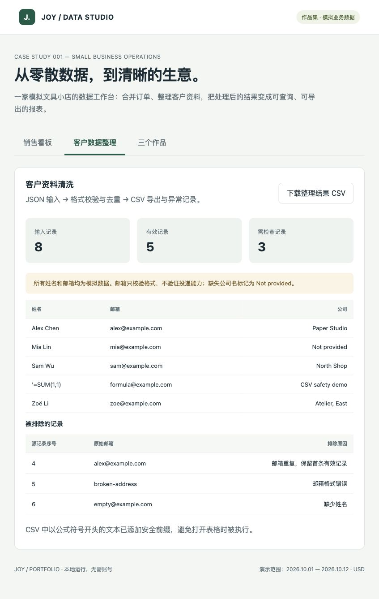

# Python 客户资料清洗与 CSV 导出

Python 3.10+，只使用标准库，不需要 pip 安装。

```sh
# 在 portfolio 目录执行，输出目录必须不存在
python3 02-python/clean_contacts.py 02-python/sample.json outputs/contacts-new
python3 02-python/test.py
```

输入为 UTF-8 JSON 数组，每条记录有字符串字段 `name`、`email`、`company`。
本演示只输出这三个字段，其他字段不会被导出。最多 10000 条。

规则：去除首尾空白、合并姓名中的多余空格、邮箱转小写；姓名必填，邮箱做基础格式校验。
邮箱重复时保留第一条有效记录，后面的记录连同原始值进入审计文件，供人工确认。
缺失公司名补 `Not provided`，不凭空补齐联系方式。
邮箱格式合格不代表真实存在或可投递；把邮箱视为大小写不敏感是此演示的业务约定。

输出：`contacts.csv`（UTF-8 BOM，Excel 友好）与 `audit.json`（输入数、保留数、排除原因）。
带逗号、引号、中文的字段由标准 CSV 写入器转义。公式起始符号前加单引号，避免打开时执行。
已有输出目录会报错，防止覆盖上一次结果。源文件保持不变。


