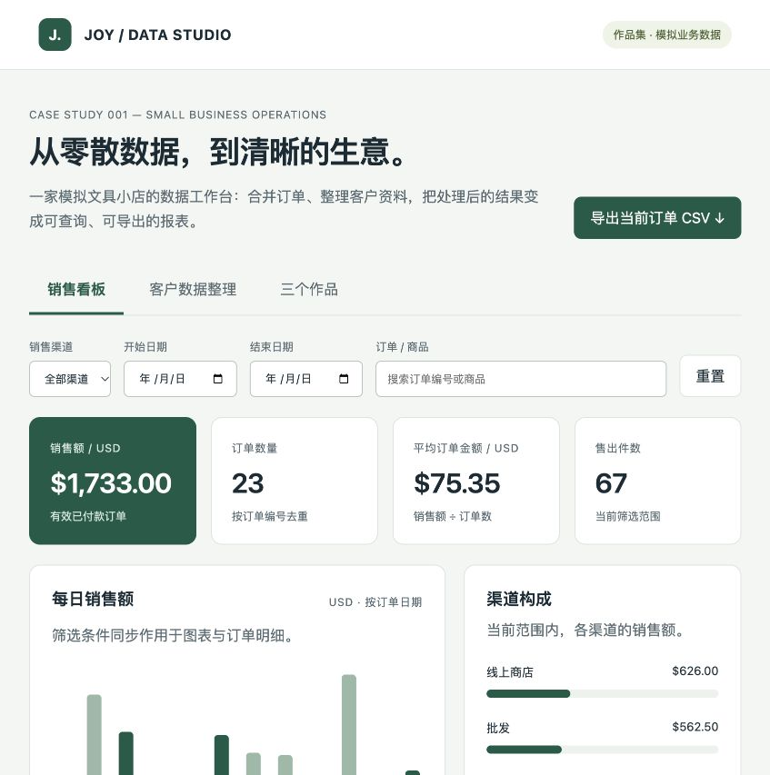

# 离线销售看板

双击 `dist/index.html`，无需安装依赖或启动服务器。
所有数据是本地模拟数据，无账号、网络接口或第三方统计脚本。

功能：按渠道、日期区间（含起止日）、订单号或商品名筛选；订单、汇总与图表同步；导出筛选后的 CSV；
切换客户清洗结果和作品介绍。小屏幕上卡片重排，表格可横向滚动。

验证方式：选线上商店、2026-10-01 到 2026-10-04，应显示 4 单、$140.00、9 件。
输入不存在的商品应显示空结果；起始日期晚于结束日期应提示错误并禁用导出。

更新数据：先生成上游 Excel/Python 结果，再在 `portfolio` 目录执行：

```sh
python3 03-dashboard/build.py
```

构建脚本读取 `outputs/demo/sales-report.json`、`outputs/demo/contacts/` 与 Excel 截图。
如需演示其他输入，可把构建脚本中的输入路径改为新的结果目录。构建完成后刷新浏览器。
`data.js` 是静态快照；这里不提供真实客户数据上传、后台账号或自动同步服务。


