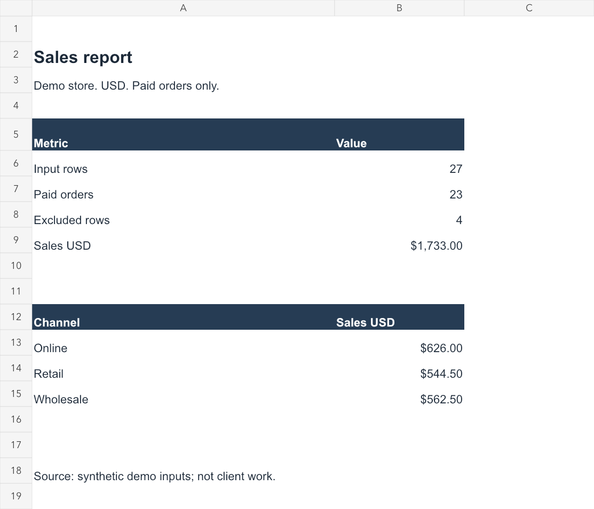

# 小店数据自动化作品集 / Small Business Data Portfolio

三个可运行的演示作品，使用自行生成的模拟订单和 `example.com` 邮箱。
**不是客户案例，不代表已获得订单或收益。** 所有金额单位为 USD。

## 先看结果

直接用浏览器打开 [`03-dashboard/dist/index.html`](03-dashboard/dist/index.html)。无需服务器、账号或联网。

| 作品 | 用途 | 交付内容 |
|---|---|---|
| [Excel 订单自动化](01-excel/README.md) | 合并多文件、多工作表，清洗订单，生成销售汇总 | 源码、两个输入文件、Excel 报表、异常清单 |
| [Python 客户资料整理](02-python/README.md) | JSON 转 CSV、格式校验、邮箱去重 | Python 源码、模拟输入、CSV、审计 JSON |
| [交互式销售看板](03-dashboard/README.md) | 日期/渠道/商品筛选、图表联动、导出 | 无依赖 HTML/CSS/JS、可离线访问 |




## 本次样例的验收标准

- Excel：27 条输入，23 条有效已付款订单，4 条排除记录；销售额 **$1,733.00**，售出 **67** 件。
- 渠道销售额：Online $626.00，Retail $544.50，Wholesale $562.50。
- 客户资料：8 条输入，5 条保留，3 条排除。姓名空白、错误邮箱、重复邮箱均保留排除原因。
- 看板：选择 Online、2026-10-01 至 2026-10-04，应得到 **4 单 / $140.00 / 9 件**。

## 运行环境

网页完全无依赖；Python 工具需要 Python 3.10+，无第三方库。
Excel 工具需要 Node.js 22+ 与 `@oai/artifact-tool`。本机已通过 Codex 自带运行库运行。
**Excel 源码目前依赖该运行库，并非随便一台电脑都能直接运行。** 已生成的 `.xlsx` 可以独立使用；
GitHub 中不会包含本机 `node_modules` 链接。其他机器需要自行提供兼容运行库后再运行 Excel 脚本。
不要将这个演示版当作已打包的 Windows 客户软件。

从 `portfolio` 目录运行：

```sh
python3 02-python/test.py
node 01-excel/test.mjs
node 03-dashboard/test.cjs
```

如果本机终端没有配置 Python/Node，可使用 Codex 自带路径：

```sh
~/.cache/codex-runtimes/codex-primary-runtime/dependencies/python/bin/python3 02-python/test.py
~/.cache/codex-runtimes/codex-primary-runtime/dependencies/node/bin/node 01-excel/test.mjs
```

## 展示时怎么说

英文作品介绍：

> A self-initiated portfolio demo using synthetic data. It combines Excel order files,
> validates and deduplicates records, produces an auditable sales report, and presents
> the results in an offline dashboard. A separate Python tool cleans customer records
> and exports spreadsheet-safe CSV. Source code, example inputs, outputs and checks are included.

演示顺序：先打开看板 → 选择日期/渠道 → 导出 CSV → 展示 Excel 的 Exceptions 表 → 展示 Python 输入与输出。
强调可验证的结果，不声称真实客户经历，也不承诺未经测量的节省时间。

## Scope and validation

Self-initiated demonstration using synthetic data, not paid client work.
See [VALIDATION.md](VALIDATION.md) for completed checks and limitations.
The Excel generator requires a compatible `@oai/artifact-tool` runtime; it is not a standalone Windows application.
